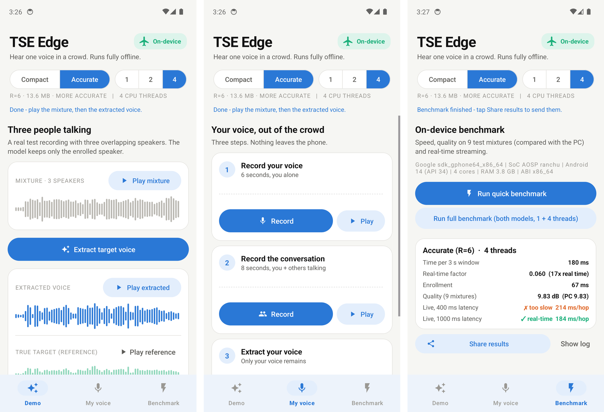
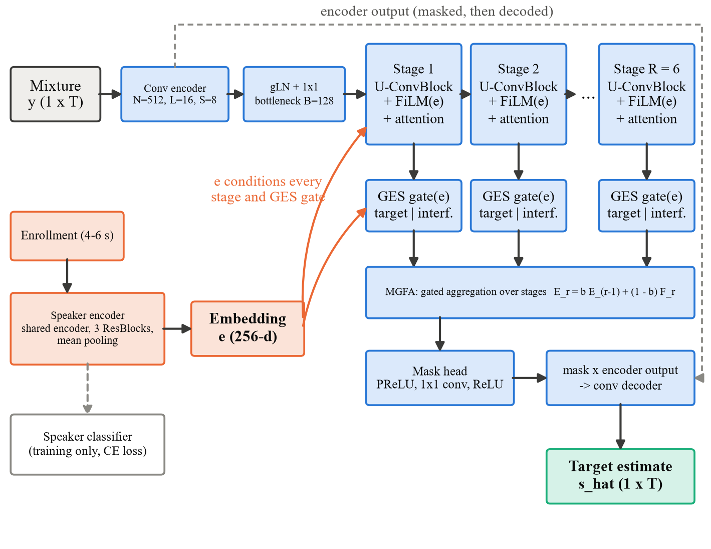
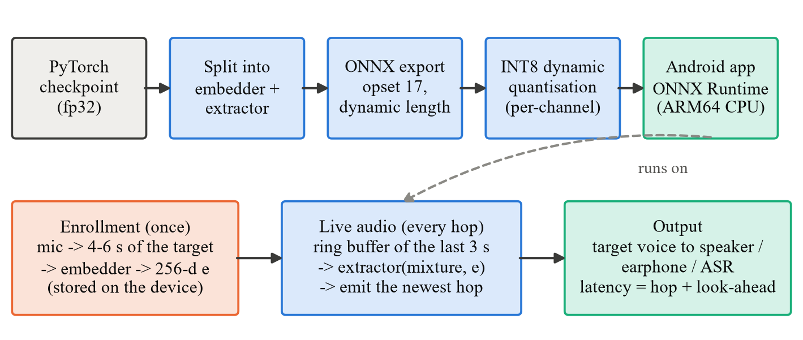
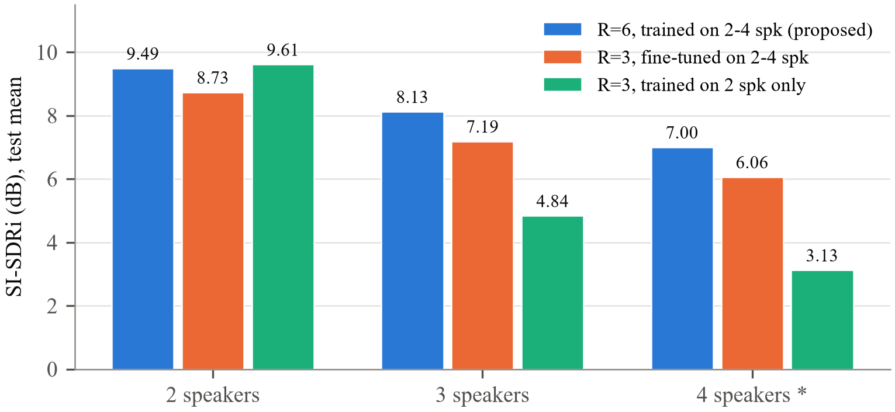

# Target Speech Extraction on Edge Device

[](https://github.com/rinolj-12/PJT1-TSE/releases/latest)
[-green?logo=android)](https://github.com/rinolj-12/PJT1-TSE/releases/download/v2.0/TSE-Edge-arm64.apk)
[-brightgreen?logo=android)](https://github.com/rinolj-12/PJT1-TSE/releases/tag/v2.0)
[](#try-the-app)

**B.Tech project, Electronics and Computer Engineering, School of Electronics Engineering (SENSE), VIT Chennai**

Johaan Sam Sanil (23BLC1286) · Rinol Jeo Manoj (23BLC1207) · Navneeth Regikumar (23BLC1276)  
Guide: A Bharathi Sankar

Several people talk at once; a short recording of one person (the "enrollment") tells the model whose voice to keep.
This project builds a compact speaker-conditioned neural network that extracts that one voice from mixtures of
**2, 3 or 4 speakers**, and runs it **fully offline on an Android phone**.

📄 **Report:** [report/TSE_on_Edge_Device_Report.pdf](report/TSE_on_Edge_Device_Report.pdf) ·
🚀 **Release:** [v2.0 Release Page](https://github.com/rinolj-12/PJT1-TSE/releases/latest) ·
📱 **Download App:** [TSE-Edge-arm64.apk](https://github.com/rinolj-12/PJT1-TSE/releases/download/v2.0/TSE-Edge-arm64.apk) ([local mirror](app/TSE-Edge-arm64.apk))



## Highlights

* **One model for 2-4 speakers.** Trained with dynamic 2-4 speaker mixing, the proposed model keeps two-speaker
  quality and greatly improves 3-4 speaker extraction compared with the same design trained on two speakers.
* **Runs on a phone.** INT8 ONNX models (13.6 MB accurate / 8.6 MB compact) in an offline
  Android app with no internet permission. On a Samsung SM-S731B the accurate model is 13x faster
  than real time with the same quality as on the PC.
* **Real-time streaming.** The compact model streams with 0.4 s latency even on a single CPU core; the accurate
  model streams with 1 s latency.
* **Eight metrics:** SI-SDRi, SNRi, SDRi, SIRi, SAR, PESQ, STOI and the wrong-speaker rate (NSR).

## How it works



A learned convolutional encoder, six U-shaped convolutional separator stages conditioned on a 256-d speaker
embedding (FiLM), speaker-gated feature splitting (GES), multi-stage gated aggregation (MGFA), a mask and a
convolutional decoder, all in the time domain at 8 kHz. For the phone the network is split into an **embedder**
(run once per speaker) and an **extractor** (run on every audio window), exported to ONNX and quantised to INT8.



## Results

### Test sets (6,000 / 9,000 / 12,000 samples)

| Test set | Model | SI-SDRi (dB) | SDRi (dB) | SIRi (dB) | PESQ | STOI | NSR |
|---|---|---|---|---|---|---|---|
| 2 speakers | R=3, trained on 2 speakers only | 9.61 | 10.12 | 17.26 | 1.60 → 2.25 | 0.858 | 5.6% |
| 2 speakers | R=3, fine-tuned on 2-4 speakers | 8.73 | 9.41 | 16.74 | 1.60 → 2.19 | 0.841 | 8.8% |
| 2 speakers | **R=6, trained on 2-4 speakers (proposed)** | 9.49 | 10.15 | 17.61 | 1.60 → 2.26 | 0.854 | 7.5% |
| 3 speakers | R=3, trained on 2 speakers only | 4.84 | 4.97 | 7.33 | 1.37 → 1.58 | 0.703 | 7.1% |
| 3 speakers | R=3, fine-tuned on 2-4 speakers | 7.19 | 7.78 | 12.85 | 1.37 → 1.67 | 0.734 | 8.3% |
| 3 speakers | **R=6, trained on 2-4 speakers (proposed)** | 8.13 | 8.76 | 14.39 | 1.37 → 1.75 | 0.756 | 7.8% |
| 4 speakers* | R=3, trained on 2 speakers only | 3.13 | 3.20 | 4.69 | 1.30 → 1.40 | 0.602 | 8.9% |
| 4 speakers* | R=3, fine-tuned on 2-4 speakers | 6.06 | 6.63 | 10.49 | 1.30 → 1.48 | 0.653 | 8.5% |
| 4 speakers* | **R=6, trained on 2-4 speakers (proposed)** | 7.00 | 7.61 | 11.93 | 1.30 → 1.54 | 0.679 | 8.5% |

\* Libri4Mix is this project's 4-speaker extension of Libri3Mix (not an official benchmark).
NSR = share of outputs worse than the mixture (wrong speaker).



### On the phone (Samsung SM-S731B, Exynos 2400, INT8)

| Model | Threads | 3 s window | Real-time factor | Enrollment | Quality, 9 test mixtures | Live 0.4 s / 1 s latency real-time |
|---|---|---|---|---|---|---|
| Compact (R=3) | 1 | 145 ms | 0.048 (21x) | 104 ms | 9.08 dB (PC 9.08) | yes / yes |
| Compact (R=3) | 4 | 116 ms | 0.039 (26x) | 79 ms | 9.08 dB (PC 9.08) | yes / yes |
| Accurate (R=6) | 1 | 275 ms | 0.092 (11x) | 97 ms | 9.84 dB (PC 9.83) | no / yes |
| Accurate (R=6) | 4 | 228 ms | 0.076 (13x) | 80 ms | 9.84 dB (PC 9.83) | no / yes |

INT8 quantisation changes SI-SDRi by -0.13, +0.02, -0.07 dB (2/3/4 speakers, accurate model) for a 4x smaller model.

### Also studied

* Multi-head and differential attention in the separator bottleneck: with the same recipe they fell behind the
  channel-attention baseline and were stopped early (report, Section 4.2).
* A frozen ECAPA-TDNN speaker encoder and an ECAPA "judge" loss: no gain (report, Section 4.5).
* FP16 inference overflows in the GES normalisation; INT8 weights are safe (report, Section 4.3.2).

## Repository

```
report/        final project report (PDF and Word)
app/           ready-to-install Android app (64-bit ARM)
android-app/   Android Studio / Gradle project of the app (INT8 models and test audio in app/src/main/assets)
model/         PyTorch code: model (src/tse), training, evaluation, edge benchmark, configs, tests
results/       measured results: test metrics, edge/quantisation, streaming, phone benchmark, training logs
docs/figures/  diagrams and charts used in the report
```

## Try the app

### Download & Installation

* **Direct APK Download:** [TSE-Edge-arm64.apk (v2.0)](https://github.com/rinolj-12/PJT1-TSE/releases/download/v2.0/TSE-Edge-arm64.apk) (~28 MB)
* **Release Page:** [v2.0 Releases](https://github.com/rinolj-12/PJT1-TSE/releases/latest)
* **Local Repo Copy:** [`app/TSE-Edge-arm64.apk`](app/TSE-Edge-arm64.apk)
* **Requirements:** Android 7.0 (API level 24) or higher, 64-bit ARM device (`arm64-v8a`).

1. **Install:** Download the APK directly on your phone or transfer it via USB. Open the file and tap **Install** (enable "Install unknown apps" for your browser/file manager if requested; if Google Play Protect shows a prompt, select *Install anyway*).
2. **Demo Tab:** Tap to extract one speaker from a bundled 3-speaker recording and compare the original mixture against the extracted speech.
3. **My Voice Tab:** Record a 3–5 second enrollment clip of yourself alone, record a second clip with multiple people speaking simultaneously, and extract your own voice.
4. **Benchmark Tab:** Run automated on-device tests measuring inference latency, real-time factor, and streaming performance directly on your phone hardware.

> **Privacy & Offline Guarantee:** Everything runs 100% on-device using INT8 ONNX Runtime. No internet access or network permissions are declared in the manifest; the app operates completely offline (even in airplane mode). Microphones are only accessed during live enrollment recording.

## Reproduce

```bash
cd model
pip install torch torchaudio --index-url https://download.pytorch.org/whl/cu128
pip install -r requirements.txt pesq onnx onnxruntime
python scripts/prepare_data.py                    # needs Libri2Mix (LibriMix) and LibriSpeech
python scripts/make_multispk_sets.py --sets 3 4 --splits dev test
python scripts/train.py --config configs/multispk_deep.yaml
python scripts/evaluate.py --ckpt runs/multispk_deep_r6/best.pt --metric-workers 8
python scripts/edge_benchmark.py --models r6=runs/multispk_deep_r6/best.pt
pytest -q
```

Android app: open `android-app/` in Android Studio, or run `./gradlew assembleRelease`.
